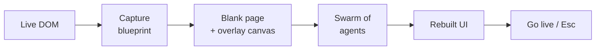

<div align="center">

<!-- Replace with your own logo/banner:  -->

# 🖱️ cursor-build

### Swarm Rebuild–style website animations, as an npm package.

Wrap your app in a provider and watch a swarm of multiplayer-style cursors<br/>
**bootstrap your own interface** — drawing boxes, typing text, pen-plotting lines and snapping to rulers.

<br/>

[](https://www.npmjs.com/package/cursor-build)
[](https://www.npmjs.com/package/cursor-build)
[](https://bundlephobia.com/package/cursor-build)
[](./LICENSE)

[](#-install)
[](#-install)
[](#-api)
[](#-quick-start--react)
[](#-quick-start--vue-3)
[](#-contributing)

<br/>

[**Quick Start**](#-quick-start--react) •
[**API**](#-api) •
[**Options**](#-options) •
[**Examples**](#-examples) •
[**How it works**](#-how-it-works) •
[**Credits**](#-credits)

</div>

---

## ✨ What is this?

Install the package, wrap your application with a provider, and a swarm of cursors takes over your page. They **capture the DOM**, **blank the page to a canvas**, then **visually reconstruct it** — dragging out boxes, typing text with a blinking caret, drawing pen lines, snapping to rulers and alt-drag-duplicating repeated components.

> **No browser extension required. No build step required.**
> Works in any app — plain HTML, React, Vue, Svelte, Next.js, Remix, Astro, anything that runs in a browser.

## 🎯 Features

| | Feature | Description |
|---|---|---|
| 🧩 | **Drop-in** | One provider or one function call. That's the whole integration. |
| 🖱️ | **Swarm of cursors** | One cursor per element: crosshair-drawn rects, typed text, pen lines, rulers, duplicates. |
| 🎹 | **Generative soundtrack** | A synthesized "glass piano" note for every element that lands. Press `M` to mute. |
| 🎬 | **Cinematic tour** | Optional auto-scroll follows the swarm below the fold. |
| 🪶 | **Zero dependencies** | Plain ESM. React / Vue are optional peer dependencies. |
| 🌐 | **Framework agnostic** | Vanilla JS core with React and Vue 3 adapters included. |
| 🫥 | **Leaves no trace** | Cursors disperse when done, and everything is cleaned up on unmount. |

## 📦 Install

```bash
npm install cursor-build
```

```bash
pnpm add cursor-build
```

```bash
yarn add cursor-build
```

The package is plain ESM with **zero runtime dependencies**. The React and Vue adapters are included and only touch their framework as an *optional peer dependency*.

## ⚛️ Quick start — React

```jsx
import { SwarmProvider } from "cursor-build/react";

export default function App() {
  return (
    <SwarmProvider autoStart startDelay={800} sound>
      <MySite />
    </SwarmProvider>
  );
}
```

That's the whole integration. On mount, `<SwarmProvider>`:

1. 📸 **Snapshots** the rendered page into a blueprint (boxes, text runs, media, borders, repeated components).
2. 🎨 **Blanks** the page behind an overlay canvas.
3. 🐝 **Spawns a swarm** of cursors that rebuild the UI live — one cursor per element.
4. 🎹 **Plays a note** for every element that lands (press `M` to mute).
5. ✅ **Offers the real page back** on completion ("Go live" / `Esc`, or just click — the build is interruptible). The hand-back is a fast crossfade over the already-visible page, so there is no flash and no dead time. On unmount it cleans up.

### Controlling the swarm from anywhere in the tree

```jsx
import { useSwarm } from "cursor-build/react";

function RebuildButton() {
  const swarm = useSwarm();
  return (
    <>
      <button onClick={swarm.replay}>Replay the build</button>
      <button onClick={() => swarm.stop(true)}>Scatter & reveal</button>
      <span>Swarm is {swarm.active ? "building…" : "idle"}</span>
    </>
  );
}
```

## 💚 Quick start — Vue 3

```js
import { useSwarm } from "cursor-build/vue";

export default {
  setup() {
    // starts on mount, stops on unmount
    const swarm = useSwarm();
    return { swarm };
  },
};
```

## 🍦 Quick start — vanilla JS / any framework

```js
import { createSwarm } from "cursor-build";

const swarm = createSwarm({
  sound: true,
  tour: true,
  // fires when everything has been rebuilt
  onComplete: ({ agents, seconds, layers }) =>
    console.log(`Rebuilt by ${agents} agents in ${seconds}s (${layers} layers)`),
});

// Start the takeover
swarm.start();

// Wire it to any button or event
button.onclick = () => swarm.toggle();
```

## 📚 API

### `createSwarm(options): SwarmController`

| Member | Description |
|---|---|
| `start(overrides?)` | Begin the takeover. Optional per-call option overrides. |
| `toggle()` | Start if idle, stop if running. |
| `stop(reveal = false)` | End it. `reveal = true` makes the cursors scatter while the real page fades back in. |
| `replay()` | Wipe and rebuild again from the top. |
| `isActive` | `true` while a swarm is running. |

> [!NOTE]
> Only one swarm can own the page at a time. Starting a new one takes over cleanly.

## ⚙️ Options

| Option | Type | Default | Description |
|---|---|---|---|
| `sound` | `boolean` | `true` | Generative glass-piano soundtrack (synthesized, mute with `M`). |
| `tour` | `boolean` | `true` | Cinematic auto-scroll while the swarm builds below the fold. |
| `hud` | `boolean` | `false` | Show the built-in HUD control bar (agent dots, layer counter, progress, exit). Hidden by default so your own UI owns the screen. |
| `disperse` | `boolean` | `true` | After the rebuild completes, cursors hold formation for a beat, then fly off-screen. Set `false` to keep them flocking like the extension. |
| `autoLive` | `boolean` | auto | Hand the live page back automatically once the swarm disperses — the overlay crossfades away over the real page (no white flash) and stops blocking clicks immediately. Default: on when the built-in HUD is hidden, off when `hud: true`. Set `true` / `false` to override. |
| `skipOnClick` | `boolean` | `true` | While the swarm owns the screen, a click/tap anywhere hands the live page back instantly (the overlay stops blocking and crossfades out) instead of leaving a non-interactive rebuild on screen. Set `false` to make the show uninterruptible (Esc still exits). |
| `skip` | `(el: Element) => boolean` | — | Exclude elements from the captured blueprint. |
| `onComplete` | `(r) => void` | — | Fires when everything has been rebuilt. |
| `onStop` | `(r) => void` | — | Fires after teardown. |

**React-only props**

| Prop | Type | Default | Description |
|---|---|---|---|
| `autoStart` | `boolean` | `true` | Start the swarm automatically on mount. |
| `startDelay` | `number` | `800` | Delay in ms before auto-start. |
| `onActiveChange` | `(active: boolean) => void` | — | Called when the swarm starts or stops. |

### ⌨️ Keyboard shortcuts

| Key | Action |
|:---:|---|
| <kbd>Esc</kbd> | Exit the swarm |
| <kbd>M</kbd> | Toggle sound |

These work regardless of whether the HUD is visible. When enabled, the HUD shows agent dots, a layer counter, a progress bar, and Touring / speed / sound / Replay / Go live controls.

## 🧪 Examples

Open the files directly in a browser (plain ESM, no bundler needed):

| Example | Description |
|---|---|
| [`examples/demo.html`](examples/demo.html) | Vanilla landing page, rebuilds on load |
| [`examples/react-demo.html`](examples/react-demo.html) | React provider + `useSwarm` via import maps |

## 🔬 How it works

The engine is ported and generalized from the [Swarm Rebuild extension](https://github.com/JoelBastoneLopez/swarm-rebuild).

<details>
<summary><b>📸 Capture</b></summary>

<br/>

Walks the live DOM, cloning computed styles, `::before` / `::after` content, inline SVG forks, form states and media into an inert document, then derives a dependency-ordered set of build tasks.

</details>

<details>
<summary><b>🐝 Orchestration</b></summary>

<br/>

Governed agents pick tasks by proximity, respect scroll frontiers, flock like boids when idle, and "leave" when their shift is over.

</details>

<details>
<summary><b>🎨 Rendering</b></summary>

<br/>

Everything lives in a shadow-DOM overlay: placeholder boxes get styled in place, text reveals char-by-char behind a real caret, and SVG paths are pen-plotted point by point.

</details>



## 🤝 Contributing

Contributions, issues and feature requests are welcome!

1. Fork the repo
2. Create your feature branch (`git checkout -b feature/amazing-idea`)
3. Commit your changes (`git commit -m "Add amazing idea"`)
4. Push to the branch (`git push origin feature/amazing-idea`)
5. Open a Pull Request

## 🙏 Credits

Built on the excellent [**Swarm Rebuild**](https://github.com/JoelBastoneLopez/swarm-rebuild) browser extension by **Dhvanil Patel** & **Joel Bastone Lopez**. The npm package generalizes the engine so any web app can ship the experience without an extension.

## 📄 License

Released under the **MIT License** — see [LICENSE](LICENSE) for details.

<div align="center">

<br/>

If you like this project, consider giving it a ⭐

</div>
